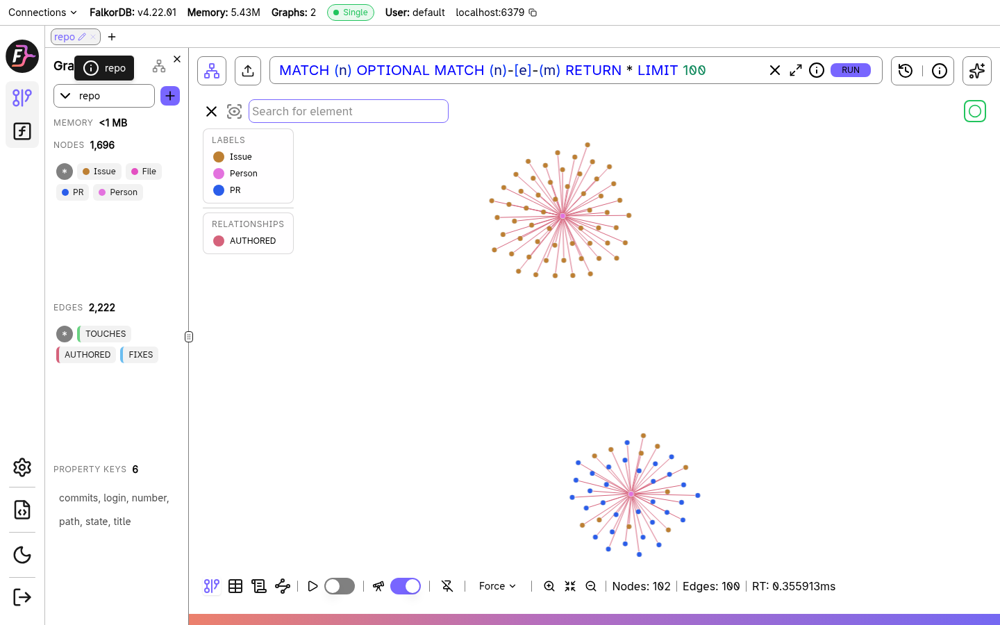
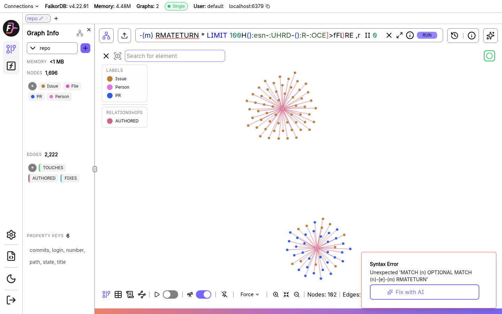

# GraphSyndesmos

Ask who knows what in a GitHub repo, and see the graph path behind every answer.

Built for Graph Hacks (WeMakeDevs x FalkorDB), Track 3: Company Brain.





## The problem

Questions about a codebase are about connections: who wrote the pull requests that touched
this file, which files change most often, who should review a change here. A plain LLM sees
isolated text and guesses. Here the data lives in a graph, so the agent follows real
relationships and can show its work.

## How it works

```
question -> local LLM (Ollama) picks a tool -> Cypher query -> FalkorDB -> answer + query shown
```

**Graph model** (`repo` graph)

- Nodes: `Person {login, commits}`, `PR {number, title, state}`, `Issue {number, title, state}`, `File {path}`
- Edges: `(Person)-[:AUTHORED]->(PR | Issue)`, `(PR)-[:TOUCHES]->(File)`, `(PR)-[:FIXES]->(Issue)`

**Agent tools** (each one is a Cypher query over the graph)

| Tool | Answers |
|---|---|
| `top_contributors` | Who authored the most PRs? |
| `hot_files` | Which files change most often? |
| `module_insights` | Which files match a path, with their PRs and contributors? |
| `who_knows_module` | Who has authored the most PRs touching a module? |
| `prs_by_person` | What has this person worked on? |

FalkorDB is the core of the product: every answer comes from a graph traversal, and the
Cypher is printed with each response so the reasoning can be checked.

## Components

- `fetch.py`: downloads contributors, issues, PRs and PR files from the GitHub API (resumable)
- `load.py`: builds the graph in FalkorDB
- `agent.py`: the CLI agent (Ollama + graph tools)
- `api.py`: FastAPI backend (`/health`, `/api/module?name=...`)
- `test_api.py`: API tests

## Setup

Requirements: Docker, Python 3.10+, [Ollama](https://ollama.com).

```bash
# 1. FalkorDB (browser UI at http://localhost:3000)
docker run -d --name falkordb -p 6379:6379 -p 3000:3000 \
  -v falkordb_data:/var/lib/falkordb/data falkordb/falkordb:latest

# 2. Python environment
python -m venv .venv
source .venv/bin/activate
pip install -r requirements.txt

# 3. Local LLM (free)
ollama pull llama3.2:3b

# 4. Get data and build the graph
export GH_TOKEN=your_github_token      # read access to public repos is enough
python fetch.py
python load.py

# 5. Ask questions
python agent.py
```

Optional: `OLLAMA_MODEL=qwen2.5:7b python agent.py` for a stronger model.
API: `uvicorn api:app --reload`, tests: `pytest`.

## Example

```
Ask: Who knows the most about anything related to graph?

[graph query] who_knows_module({'name': 'graph'})
MATCH (p:Person)-[:AUTHORED]->(pr:PR)-[:TOUCHES]->(f:File)
WHERE toLower(f.path) CONTAINS toLower($module)
RETURN p.login AS person, count(DISTINCT pr) AS prs
ORDER BY prs DESC LIMIT 5

Answer: AviAvni, swilly22, GomezGab, aniruddhaadak80, and alblancc know the graph-related files best.
```


## Limitations and next steps

- Uses the first 100 PRs' file lists to keep API usage small, so file-level rankings are a sample, not the full history.
- Small local models sometimes choose the wrong tool; a larger model helps.
- Tests (`pytest`) need FalkorDB running with the `repo` graph loaded via `load.py`.
- Next: store questions and answers in the graph so the agent remembers across sessions (Track 2), and add review and issue-ownership tools.

## Demo video

VIDEO_LINK_HERE

